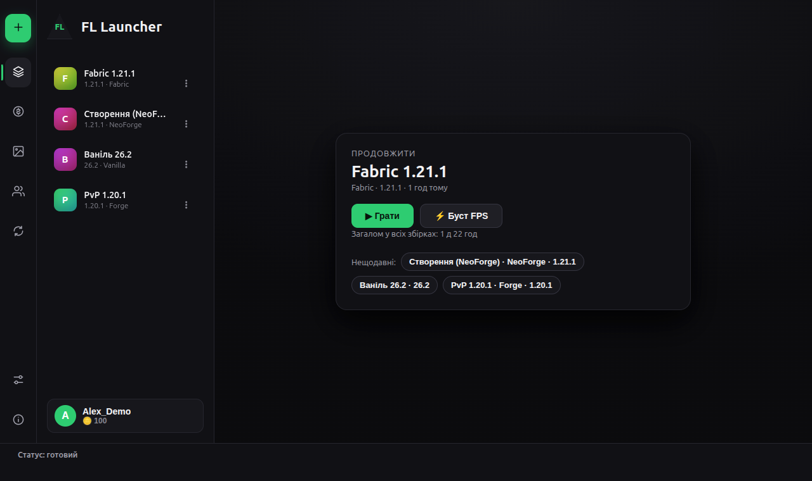
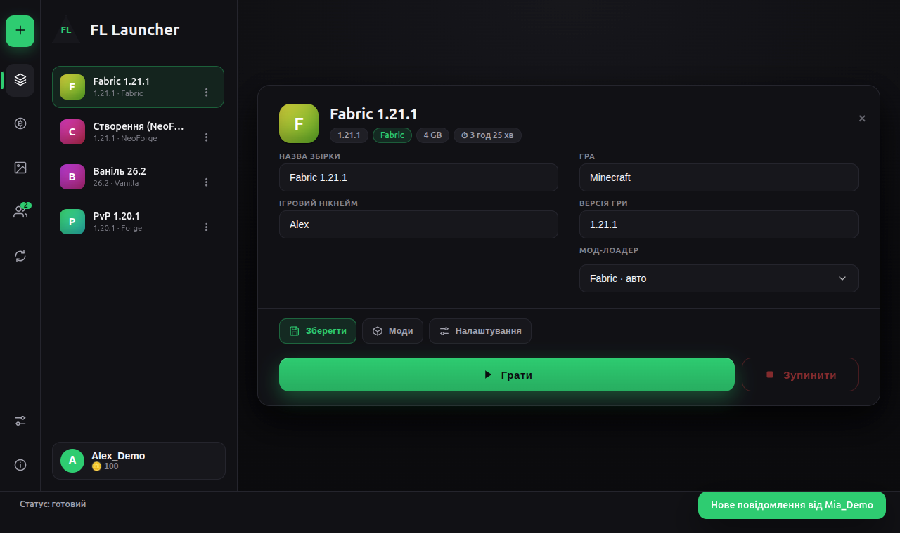
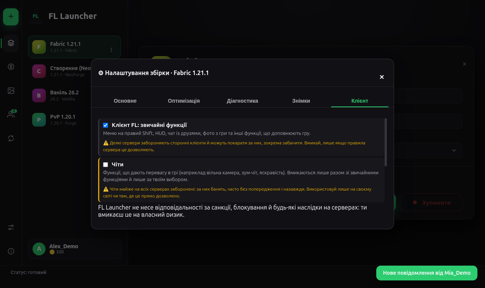
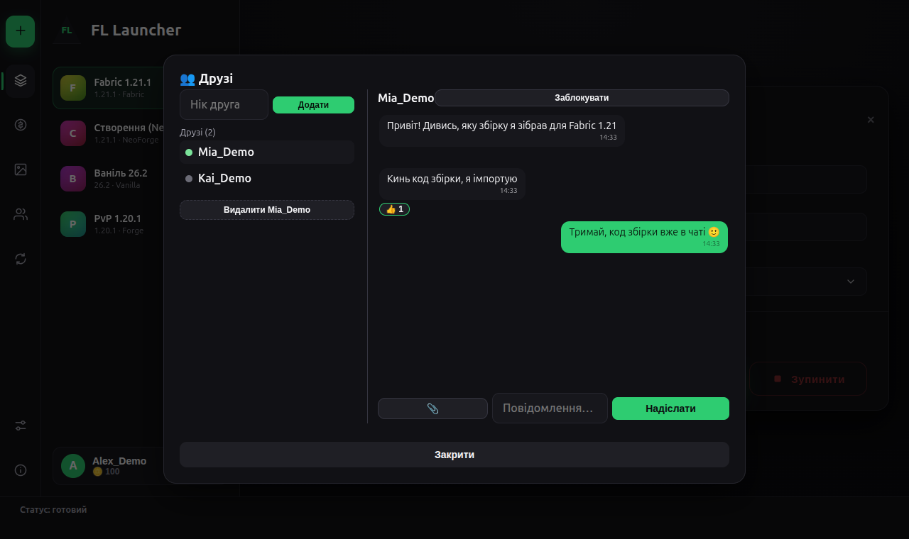

# FL Launcher — Releases

*[Українською](README.uk.md)*

This repository contains **only the built releases** of FL Launcher.
There's no source code here.

## Screenshots

| Home ("Continue") | A build |
|---|---|
|  |  |
| **Client tab: regular features and cheats are separate switches** | **Friends and chat (history stays on your computer)** |
|  |  |

*The screenshots use demo accounts and the Ukrainian interface (English and Russian are available too). The in-launcher "Everything about FL Launcher" window:* [screenshot](docs/img/about-features.png).

## Quick start

1. **Download** the latest installer from [Releases](https://github.com/Faneraiy14/fl-launcher/releases/latest) and install it (Windows `.exe`; Linux `.AppImage` or `.deb`).
2. **Create a build**: the green **+ Create** button → *Create a build*, pick the game version and (if you want) a loader. Or paste a friend's code via *Import by code*.
3. **Press Play.** Java and the game files are downloaded automatically on the first launch.

## Download

Grab the latest version from the [Releases](https://github.com/Faneraiy14/fl-launcher/releases/latest)
page:

- **Windows** — `FL-Launcher-Setup-*.exe`
- **Linux, Ubuntu / Debian / Mint / Pop!_OS** — `fl-launcher_*_amd64.deb` (recommended): double-click it and install through the Software app, or `sudo apt install ./fl-launcher_*_amd64.deb`. The launcher appears in the app menu.
- **Linux, any other distribution** — `FL-Launcher-*.AppImage`

After that, the launcher updates itself: it checks for new releases on
startup and offers to install them.

> Windows may show a blue "Windows protected your PC" screen — the
> project doesn't have a paid signing certificate. Click "More info",
> then "Run anyway".

> **AppImage does nothing on double-click?** Linux doesn't let a freshly
> downloaded file run as a program until you allow it. Do it once:
> right-click the file → *Properties* → enable *Allow executing file as
> program* (the wording depends on the file manager), or in a terminal:
> `chmod +x FL-Launcher-*.AppImage`. After the first launch the launcher
> adds itself to the app menu with its icon, and updates keep that
> permission.

## What FL Launcher is

An Electron-based Minecraft launcher: manages instances, automatically
installs Fabric, Forge, NeoForge, and Quilt, lets you search and
install mods, manage skins, and includes its own FL Loader mod loader.
On top of that: built-in optimization and a "repair the build" tool,
snapshots with rollback, trial copies and shareable build codes, an
in-game client (HUD, menu, chat) with separate switches for regular
features and cheats, cosmetics with an in-game currency, and friends with
a chat whose history is kept only on your own computer.

**Full feature list, by block: [FEATURES.md](FEATURES.md)**
(the same text is inside the launcher: the ⓘ button at the bottom of the left panel → About → Everything about FL Launcher).

## What makes it different

Things most launchers do not have all in one place:

- **Repair the build**: reads the real crash or log, explains what broke and fixes it with undo; nothing is deleted.
- **Snapshots, trial copies and build codes**: try mods safely, roll back in one click, share a build as a short code.
- **Optimization with measurement**: profiles, GPU choice with a built-in benchmark, FPS mods only after your confirmation.
- **Own mod loader (FL Loader)** and an in-game client whose regular features and cheats are **separate switches**, with clear ban warnings.
- **Chat with friends where the history stays on your computer**, not on a server.

## Requirements

| | |
|---|---|
| **OS** | Windows 10 / 11 (64-bit); Linux (64-bit): `.AppImage` for any distribution, `.deb` for Debian/Ubuntu-based ones |
| **Minecraft** | 1.14.4 – the newest 26.x with FL Loader; for Fabric, Quilt, Forge and NeoForge — the versions those loaders support |
| **Java** | nothing to install: the launcher downloads the right one for each game version |
| **RAM** | 8 GB in the system is comfortable (the game itself usually gets 3–6 GB depending on the build and mods) |
| **Disk** | the installer is about 100 MB; each game version with its libraries takes roughly 0.5–1 GB, plus your worlds and mods |

> **What is "26.x"?** Mojang switched to year-based version numbers: 26.1, 26.2, 26.3 … are the 2026 releases of Minecraft.

## Other parts of the project

| Repository | What's there |
|---|---|
| [fl-bridge](https://github.com/Faneraiy14/fl-bridge) | releases of `FLBridge.jar` — the mod loader the launcher downloads on its own |
| source code | in a private repository |

## Files in a release

- `FL-Launcher-Setup-X.Y.Z.exe` — the Windows installer
- `fl-launcher_X.Y.Z_amd64.deb` — the package for Debian/Ubuntu-based Linux
- `FL-Launcher-X.Y.Z.AppImage` — Linux, any distribution
- `latest.yml`, `latest-linux.yml` — the auto-update manifests the launcher needs
- `.blockmap` — lets updates download only the changed parts

## License

The contents of this repository (documentation and the release channel) are under the [MIT License](LICENSE). The launcher is distributed free of charge and as is, without warranty; its source code is private.

## Feedback

Found a bug or want a feature? Open an [issue](https://github.com/Faneraiy14/fl-launcher/issues) — for a bug, please include the launcher version, your OS, what you did and the "🩺 Report" text from the launcher (it contains no tokens or passwords).
